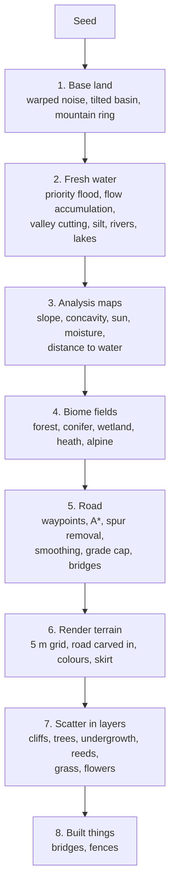

# How Riverlands is generated

Riverlands is the second world in the Godot project: an autumn river basin built from a
seed each time it loads (~4.5 s). No art assets, no external tools. Everything is
GDScript and shaders in this repo. This document covers the pipeline, the logic of each
step, the parameters that shape it, and the tools used to build and check it.

The code lives in `scripts/worlds/riverlands/` and uses the shared code in
`scripts/common/`.

## Where the approach comes from

The *order* of the steps follows Ubisoft's GDC 2018 talk *Procedural World Generation of
Far Cry 5* (Etienne Carrier). We worked from public notes on it
(<https://tools.engineer/toolshed/gdc2018-procedural-world-generation-of-far-cry-5>);
the slides and video are behind GDC Vault. The notes give this outline:

- analyse the terrain first, and let every later tool read those results;
- fresh water (rivers, lakes) before vegetation, and cliffs on steep ground;
- biomes as rule sets ("recipes") that react to terrain features: near water, near
  cliffs, at high altitude;
- placement in layers; roads, then fences;
- determinism: the same input always gives the same world.

Nothing else comes from the talk. Ubisoft used Houdini with hand-authored terrain and
artist-painted biomes. Here the terrain itself is generated, every step is our own code
built on standard algorithms (listed with references at the end), and the rule
thresholds were tuned by eye from screenshots and the top-down map.

## Pipeline



| Step | Code | Typical time |
|---|---|---|
| 1-2 Base land, water | `RiverLand.build()` | ~0.45 s |
| 3-4 Maps, biomes | `RiverLand._analyse()` | ~0.25 s |
| 5 Road | `RiverRoad.plan()`, `Route.build_loop()` | ~0.45 s |
| 6 Terrain and water meshes | `RiverLand.make_heights()`, `carve()`, `build_mesh()`, `water_mesh()` | ~0.85 s |
| 7 Trees and big props | `RiverScenery._cliffs()`, `_trees()`, `_undergrowth()` | ~1.2 s |
| 7-8 Small props, built things | `_reeds()`, `_grass()`, `_bridges()`, `_fences()` | ~1.3 s |

Times are from the Linux dev box (seed 7). Each step prints its time to the console.

## Coordinates and grids

- Metres, y up. The playable land is the square −1400…1400 m in x and z (`HALF`).
- **Analysis grid**: 10 m cells, 281 × 281 (`A_STEP`, `NA`). Water, maps and biomes
  live here. It's coarse enough to process quickly in GDScript and fine enough for
  rivers and forests.
- **Render grid**: 5 m, 561 × 561 (`STEP`, `N`). This is the ground mesh, built from the
  analysis heights plus small detail, with the road carved in.
- **Skirt**: rays from the render grid's edge out to 9 km (`FAR`) for the mountains on
  the horizon. It reuses the edge vertices, so there's no seam.
- **Edge fade**: in the outer 260 m, everything blends back to the base land and no water
  is placed, so the land meets the skirt cleanly (`_edge()`).

Maps are read anywhere with `RiverLand.field(map, x, z)` (bilinear). The nearest-cell
lookups are `cell()` and `water_at()`.

## 1. Base land

`RiverLand.base(x, z)` is the land before water shapes it. It's the sum of:

- **Hills**: fractal noise (`FastNoiseLite`, frequency 0.0011, 5 octaves) × 80 m. The
  sample point is first pushed around by a second, slower noise (±160 m "domain warp"),
  which makes the hill shapes less blobby and gives winding ridges.
- **Tilt towards the outlet**: −0.035 × (distance along a seed-chosen direction), up to
  ±49 m. Without it the basin would drain nowhere and become one big lake.
- **Mountain ring**: ridged fractal noise for sharp crests, 180-830 m, faded in from
  850 m to 2600 m from the centre. In the outlet direction the ring is cut by 85 %,
  leaving a gap where the river leaves.

The same function feeds the skirt, so the mountains on the horizon match the land.

## 2. Fresh water

This is the step that makes the land look like land. The idea is to simulate where rain
would run off, then let that shape the ground.

### Priority flood (`_flood()`)

All edge cells go into a min-heap keyed by height. Repeatedly take the lowest cell and
visit its 8 neighbours. Each neighbour gets height `max(own height, current + 0.001)` and
remembers the current cell as `parent`, the cell it drains into.

What comes out:

- **`filled`**: the height every hollow fills up to before it overflows. Where it's above
  the ground, a lake would form. The 0.001 m step makes even flat lake surfaces drain
  somewhere, so every cell has a path to the edge.
- **`parent`**: one drainage direction per cell. Together they form a tree of flow paths
  to the map edge.
- **`order`**: the order cells were reached in. A cell is always reached after the cell
  it drains into.

The heap is `common/min_heap.gd`.

### Flow accumulation (`_accumulate()`)

Every cell starts with 1 (its own rain). Walking `order` backwards, each cell adds its
total to its `parent`. Afterwards, `acc[c]` is how many cells drain through `c`, i.e. its
catchment area in units of 100 m².

### Shaping the land (`build()`)

1. **First flood** on the base land.
2. **Valley cutting**: each cell is lowered by `min(24, 3.2 × ln(1 + acc / 6))` metres,
   blurred twice (radius 2 cells) so valleys get a rounded floor. Big rivers cut deep,
   gullies cut a little. This is a simplified form of the "stream power" law in
   landscape modelling: erosion grows with the water flowing through.
3. **Silt**: hollows are filled 80 % of the way to their overflow height (`SILT`). Real
   basins fill with sediment, and this turns most would-be lakes into flat plains.
4. **Second flood** on the shaped land gives the final water:
   - **Lake** where the fill depth is over 2 m (`LAKE_DEPTH`): water at the fill height
     minus 0.2 m.
   - **River** where `acc ≥ 450` (0.045 km² of catchment, `RIVER_ACC`): water 0.3 m below
     the bank, bed `0.8 + 0.5 × ln(acc / 450)` m deeper (0.8-3.5 m).
   - Rivers with 12× that catchment are widened to their 8 neighbours at the same water
     level.

The results are `ha` (final ground height), `wl` (water surface, or `DRY`) and `acc`.

The water surface (`water_mesh()`) is built only around wet cells: wet vertices sit at
the water level, and dry neighbours sit 1.5 m under the ground, so the surface dips into
the banks and the shoreline is wherever the two cross.

## 3. Analysis maps

`_analyse()` computes, per 10 m cell:

| Map | Meaning | How |
|---|---|---|
| `slope` | 0 flat … 1 vertical | 1 − normal.y, normal from central differences |
| `conc` | concavity in m: + in hollows, − on ridges | height blurred twice over ±60 m, minus height |
| `sun` | 0 facing away … 1 facing the sun | normal · sun direction, scaled so flat ground ≈ 0.5 |
| `dw` | distance to water in m | two-pass chamfer distance transform (10 m / 14.1 m steps) |
| `wnear` | level of the nearest water | carried along by the same chamfer passes |
| `moist` | 0 dry … 1 wet | 0.55 × e^(−dw/45) + 0.3 × ln(acc)/7 + concavity/15 (clamped ±0.3) |

The sun direction is the same one the scene's light uses (`SUN_PITCH`, `SUN_YAW`), so
dry, sun-facing slopes are the ones that look lit.

## 4. Biome fields

Each cell gets five weights from 0 to 1. `pn` is a slow "patches" noise that breaks up
straight edges. `smoothstep(a, b, x)` ramps from 0 at `a` to 1 at `b`.

| Field | Rule | Reads as |
|---|---|---|
| `alpine` | max(smoothstep(230, 330 m, height + 40·pn), smoothstep(0.32, 0.5, slope)) | high or steep: rock |
| `wet` | e^(−dw/14) × flat (slope < 0.06…0.18) × (1 − alpine) | wetland by the water |
| `forest` | smoothstep(0, 0.45, 0.9·pn + 0.7·moist − 0.12) × (1 − alpine) × (1 − 0.8·wet), halved on slopes 0.25…0.4 | woods where it's moist |
| `conifer` | smoothstep(60, 190 m, height) + 0.9 × (0.45 − sun) + noise | share of conifers: high or shady |
| `heath` | smoothstep(0.7, 0.95, sun + 0.3·(1 − moist) − 0.03·conc) × (1 − forest)(1 − alpine)(1 − wet) | dry, sunny, convex |

Meadow is whatever is left. These are the "recipes" from the talk, written as formulas.

### Ground colour

`_ground_color()` starts from meadow green blended with gold by a tint noise, then mixes
in, in order: heath ochre (with purple heather patches), leaf litter under broadleaf
forest, needles under conifers, lush green for wetland, rock, grey rock higher up.

Per render vertex, `vertex_color()` adds:
- mud just above nearby water (within 1.6 m of its level, fading out by 30 m away);
- rock on steep faces;
- snow above ~600 m;
- dirt along the road edge.

All colours are sRGB constants at the top of `river_land.gd`.

## 5. Road

`RiverRoad.plan()` lays out the route like an engineer would.

1. **Waypoints**: 7 around the basin, 520-820 m from the centre at seed-jittered angles.
   Each one moves to the gentlest dry cell within ±60 m (`_best_cell()`: low slope, not
   alpine, not in or next to water).
2. **A\*** between consecutive waypoints on the analysis grid (8 neighbours). The cost
   of each step (length `L`, grade `g` between water surfaces or ground):

   `L × (1 + 400·g² + 4·slope + 3·alpine)`, plus `14·L` if the cell is water.

   The grade term makes climbing expensive, so the road follows valleys or traverses
   slopes. Water is costly but allowed, which gives a few bridges, not none. The
   heuristic is straight-line distance × 1.3: slightly greedy, much faster, close enough
   to optimal.
3. **Spur removal** (`_drop_spurs()`): where the path comes back within 25 m of a point it
   passed earlier (within under 45 % of the loop), the excursion between is cut. This
   removes "out to a waypoint and back the same way" dead ends and tight hairpins. It
   runs twice, the second time with the loop rotated half-way, because a spur can sit
   exactly at the start/end waypoint.
4. **Shape**: three passes of a moving average (±3 points).

Then the shared `Route.build_loop()` (`common/route.gd`) turns it into a road:

1. Resample every ~2 m.
2. Heights from the ground (`ha`), averaged 3 times over ±40 m.
3. **Grade cap at 7.5 %** (`_limit_grade()`). It computes the highest profile that stays
   at or under the ground and the lowest that stays at or over it, both within 7.5 % per
   step (two forward and two backward passes around the loop), then averages them. The
   average of two profiles within the cap is within it too, so this is exact. The
   earlier step-by-step version ran out of passes on hilly ground; this one is linear
   time.
4. **Floor over water**: at least 2.2 m above the water at that point
   (`RiverLand.road_floor()`), then capped again. That lifts the road onto its bridges,
   with ramps on either side.
5. A last light smoothing (±4 points).

**Bridges** (`RiverWorld._bridges()`): route points over a wet cell, widened by 4 points
(8 m) each side for the abutments.

Steepest 2 m step on both worlds' roads (seed 7): 7.50 %.

## 6. Render terrain

1. `make_heights()`: the 5 m grid samples `ha` bilinearly and adds ±0.8 m of fine noise,
   faded out near water so river banks stay clean.
2. `carve()`: for every grid point within 48 m of the road, record the distance to the
   road and the road's height there. Within ~10 m the ground goes to 0.15 m under the
   road; from there it blends back to the natural height by 48 m, giving cuttings and
   embankments. Points within 4-14 m of water are left alone, so the river stays open
   under bridges.
3. `build_mesh()`: the grid plus the skirt in one mesh, with vertex normals and colours.

## 7. Scatter in layers

`RiverScenery.build()`. Every layer:

1. takes candidate points from a jittered grid (`_candidates(spacing)`);
2. keeps each with a probability from the biome fields;
3. checks the spot is dry and off the road (`_dry()`);
4. for the bigger props, checks the spot against **footprints**: circles left by
   earlier, bigger props, kept in a 12 m spatial hash (`Footprints`).

Layers run biggest first, so small things fill in around big ones, never the other way.

| Layer | Spacing | Chance | Footprint | Notes |
|---|---|---|---|---|
| Cliff rocks | 11 m | smoothstep(0.22, 0.4, slope) | 0.45 × size (5-10 m) | Tilted halfway between the slope and upright; faceted with strata bands |
| Trees | 7.5 m | 0.9 × forest + small chance for lone trees | 2.4 m | Species picked per tree, see below |
| Bushes | 3.5 m | 0.35 × forest edge + 0.2 × wet + 0.08 × heath + 0.04 × forest | 1.0 m | Forest edge = 4·f·(1 − f): highest where the forest thins out |
| Logs and stumps | 14 m | 0.35 × forest | 1.8 m | 60 % logs |
| Boulders | 16 m | 0.05 + 0.35 × alpine + 0.15 × heath | 1.5 m | Size 0.8-3.5 m |
| Reeds | 4 per cell within 15 m of water | at shore height: 0.7 m under to 0.9 m above the nearest water | none | Some with cattail heads; not in the outer 300 m |
| Grass | 110 per 2 m of road, out to 110 m | 1 − 0.7 × forest − 0.85 × alpine (≥ 0.1) | none | Colour = biome ground colour |
| Wildflowers | with the grass | 6 % × meadow | none | White, yellow, purple |

**Tree species**, per tree:
1. With probability `conifer`: pine or spruce (50/50).
2. Otherwise, a birch if within 60 m of water (45 %) or at the thin edge of a forest
   (30 %).
3. Otherwise a broadleaf. Its colour (green, yellow, orange or red) comes from a slow
   noise plus a random nudge, so colours come in patches with strays, like a real
   autumn wood.

**Rendering**: each species goes into an `Instancer` (`common/instancer.gd`): instances
are grouped into square chunks (200 m for trees, 64 m for bushes, 32 m for grass), one
MultiMesh per chunk, so the GPU culls whole chunks. Trees have two levels of detail:
full meshes out to 450 m and one-blob/one-cone versions from 450 m to 2.2 km. Grass
shrinks into the ground between 65 and 110 m in its shader, so its 125 m cut-off never
pops.

## 8. Built things

- **Bridges** (`_bridges()`): side beams under the deck edges, posts every 4 m, a top rail,
  and piers every 12 m down to the ground or river bed wherever the deck is over a metre
  up. The deck itself is the road surface painted in plank colours (`Roads.ribbon()` with
  the bridge mask).
- **Fences** (`_fences()`): wooden posts every ~4 m, 1.4 m off the road edge, with two
  rails, wherever the land beside the road is open (forest < 0.15, alpine < 0.2, more than
  8 m from water, not a bridge). Each run is on one side; after a run ends, the next one
  switches side half the time.

All of these are boxes from `_beam()`, merged into one mesh.

## Determinism and seeds

Everything comes from `--seed` (default 7): the noise generators are seeded from it
(`seed`, `seed + 1`, …), the outlet direction and waypoints from their own
`RandomNumberGenerator`s, and the scatter from one generator seeded `seed + 100`.

The scatter's generator is shared across layers, so **the order of draws matters**.
Adding a draw early (for example a new layer before the trees) shifts every later
layer's choices. The world is still valid, just different. Add new layers at the end,
or give them their own generator, to keep existing seeds looking the same.

## Tools

| Tool | Used for |
|---|---|
| Godot 4.7.2 (Forward+) | Engine, rendering, `--headless` runs |
| GDScript | All generation code |
| `FastNoiseLite` (built in) | Simplex fractal and ridged noise |
| `ArrayMesh` via `MeshBuilder` | Terrain, water, props, bridges, fences. `MeshBuilder.tri()` sets the winding from the normals |
| `MultiMesh` via `Instancer` | Chunked, instanced props with LOD |
| Spatial shaders | Toon lighting shared through `toon.gdshaderinc`; grass wind and fade; water depth colour and foam; painterly sky |
| `Image` | The top-down map |

Nothing else: no Houdini, no plugins, no downloaded assets.

### Checking a world

```bash
# screenshot from 1.5 km along the road, then quit
godot --path world/godot --windowed --resolution 1280x720 -- \
      --world=riverlands --seed=7 --at=1500 --power=200 --shot=/tmp/shot.png

# top-down map: ground colours, forests darker, water blue, road red
godot --path world/godot -- --world=riverlands --map=/tmp/map.png --shot=/tmp/x.png
```

The console shows each step's time, the prop counts and where the bridges are
(`bridges at: 2073 m, …`). Use those distances with `--at` to look at a bridge.

The map is the fastest way to judge a seed and to tune the water and biome numbers.
Screenshots are for the look.

For the grade, a throwaway script run with `godot --headless -s` that builds the worlds
and prints the steepest 2 m step was used. It isn't kept in the repo.

## Tuning guide

| Want | Change |
|---|---|
| Fewer or more lakes | `LAKE_DEPTH` (higher = fewer), `SILT` (higher = more hollows become plains) |
| More or fewer rivers | `RIVER_ACC` (lower = more, smaller streams) |
| Deeper valleys | the 3.2 and the 24 m cap in the valley-cutting formula |
| Hillier land | hill amplitude (80 m) in `base()`; the road then needs more cut and fill |
| More forest | the −0.12 in the `forest` rule (lower = more) |
| More conifers | the 60-190 m band or the 0.9 sun weight in `conifer` |
| Road avoids rivers more | the `14·L` water cost in `_astar()` |
| Flatter road | the `400·g²` grade cost, and `Route.MAX_GRADE` |
| Autumn colours | `GREEN`, `YELLOW`, `ORANGE`, `RED`, `BIRCH`, `BUSH_TINTS` in `river_scenery.gd` |
| Light and haze | the `Look.apply()` overrides in `river_world.gd` |
| Performance | `GRASS_PER_SAMPLE`, tree spacing (7.5 m), `TREE_DETAIL`, `TREE_VISIBLE` |

## Known limitations

- Rivers are on the 10 m grid, so they're at least ~10 m wide and their courses step
  slightly. A finer water mesh or a river spline would fix it.
- The rider's camera can pass close to a tree trunk on a bend: trees keep 4 m from the
  road edge, and the camera sits 1 m right of centre.
- Grass right beside the road can be more golden than the ground under it, because the
  ground there blends to road dirt at the render grid's 5 m spacing.
- Some seeds may still give an odd road (a long detour, a crossing over itself). Check
  the map.
- Not yet measured on the Windows ride PC: about 250k grass clumps, 12k trees and 80k
  bushes.

## References

- E. Carrier, *Procedural World Generation of Far Cry 5*, GDC 2018 (notes:
  <https://tools.engineer/toolshed/gdc2018-procedural-world-generation-of-far-cry-5>;
  talk: <https://www.gdcvault.com/play/1025557/Procedural-World-Generation-of-Far>).
- R. Barnes, C. Lehman, D. Mulla, *Priority-Flood: An optimal depression-filling and
  watershed-labeling algorithm for digital elevation models*, Computers & Geosciences,
  2014: the flood and the ε step.
- G. Borgefors, *Distance transformations in digital images*, Computer Vision, Graphics,
  and Image Processing, 1986: the two-pass chamfer distance.
- P. Hart, N. Nilsson, B. Raphael, *A Formal Basis for the Heuristic Determination of
  Minimum Cost Paths*, 1968: A\*.
- Flow accumulation and the stream power law are standard in hydrology and landscape
  evolution modelling. The versions here are simplified.
