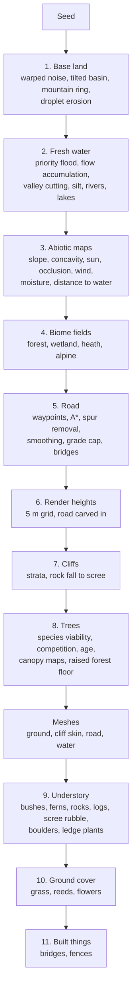

# How Riverlands is generated

Riverlands is the second world in the Godot project: an autumn river basin built from a
seed each time it loads (~30 s on the dev box; build time doesn't matter here, quality
does). No art assets, no external tools. Everything is
GDScript and shaders in this repo. This document covers the pipeline, the logic of each
step, the parameters that shape it, and the tools used to build and check it.

The code lives in `scripts/worlds/riverlands/` and uses the shared code in
`scripts/common/`.

## Where the approach comes from

The approach follows Ubisoft's GDC 2018 talk *Procedural World Generation of Far Cry 5*
(Etienne Carrier). We worked from the slides and the talk's transcript (kept locally in
`world/`, ignored by git, not ours to share) and public notes. From the talk we took:

- **order and data flow**: terrain data first; each tool writes masks the next ones read
  (water → roads → cliffs → biomes);
- **abiotic data**: occlusion, flow, slope, curvature, illumination (slope aspect),
  altitude, wind; the pillars of every biome rule;
- **main biomes split into sub-biomes** (forest, grass) by that data;
- **species viability**: each species builds its own viability by combining terrain data
  through ramps, adding noise warped by the terrain normal, and multiplying by exclusion
  masks; species compete for ground with a **priority radius** checked before a
  **viability radius**;
- **age**: a signed distance field into the forest that drives tree size (young at the
  edges, old in the core, regrowth at a chosen depth), with scale bridging between sizes;
  smaller, sparser trees up high; density following size;
- **entities changing the terrain**: soil raised under trees, ground texture and colour
  under them, and their own masks feeding later species (rocks around conifers);
- **per-instance colour** from terrain data (rust grass by the water), **rotation** from
  the slope (grass leaning to water) or a **wind map** that bends around hills;
- **the cliff tool**: a skin over slopes past a threshold, sliced into strata of random
  thickness at a few angles, split by a blocky noise into two groups with different
  seeds, extruded and displaced; strata colour carried onto the terrain; a flow
  simulation from the cliffs for erosion that keeps the strata colour, with crumbled
  rocks; vegetation on upward faces that are clear above;
- **determinism**, and **terrain data computed inside the tools** rather than cached.

What's different: Ubisoft worked in Houdini on hand-sculpted terrain with artist-painted
biomes and hand-placed rivers. Here everything is generated, all code is our own GDScript
built on standard algorithms (references at the end), and the thresholds were tuned by
eye from screenshots and the top-down map. Their talk gives no numbers for its rules;
every number here is ours.

## Pipeline



| Step | Code | Typical time |
|---|---|---|
| 1 Erosion | `RiverLand._erode()` | ~3.9 s |
| 2-4 Water, maps, biomes | `RiverLand.build()` | ~5 s |
| 5 Road | `RiverRoad.plan()`, `Route.build_loop()` | ~1.9 s |
| 6 Render heights | `RiverLand.make_heights()`, `carve()` | ~0.7 s |
| 7 Rock fall | `RiverCliffs.simulate_scree()` | ~0.8 s |
| 8 Trees | `RiverEcology.place_trees()`, `build_trees()` | ~3 s |
| Meshes | `RiverLand.build_mesh()`, `RiverCliffs.build_skin()`, `water_mesh()` | ~7.3 s |
| 9 Understory | `RiverEcology.build_understory()` | ~4.2 s |
| 10-11 Ground cover, built things | `RiverScenery._reeds()`, `_grass()`, `_bridges()`, `_fences()` | ~3.8 s |

Times are from the Linux dev box (seed 7, ~30 s in all). Each step prints its time.

## Coordinates and grids

- Metres, y up. The playable land is the square −1800…1800 m in x and z (`HALF`).
- **Analysis grid**: 5 m cells, 721 × 721 (`A_STEP`, `NA`). Radii and distances in the
  code are given in metres (`blur_m()`, `… / A_STEP`), and flow is counted as area in
  100 m² units, so the grid can change without retuning. Water, maps and biomes
  live here. It's coarse enough to process quickly in GDScript and fine enough for
  rivers and forests.
- **Render grid**: 5 m, 721 × 721 (`STEP`, `N`). This is the ground mesh, built from the
  analysis heights plus small detail, with the road carved in.
- **Skirt**: rays from the render grid's edge out to 10 km (`FAR`) for the mountains on
  the horizon. It reuses the edge vertices, so there's no seam.
- **Edge fade**: in the outer 260 m, everything blends back to the base land and no water
  is placed, so the land meets the skirt cleanly (`_edge()`).

Maps are read anywhere with `RiverLand.field(map, x, z)` (bilinear). The nearest-cell
lookups are `cell()` and `water_at()`.

## 1. Base land

`RiverLand.base(x, z)` is the land before water shapes it. It's the sum of:

- **Hills**: fractal noise (`FastNoiseLite`, frequency 0.0011, 5 octaves) × 80 m. The
  sample point is first pushed around by a second, slower noise (±160 m "domain warp"),
  which makes the hill shapes less blobby and gives winding ridges.
- **Tilt towards the outlet**: −0.035 × (distance along a seed-chosen direction), up to
  ±49 m. Without it the basin would drain nowhere and become one big lake.
- **Mountain ring**: ridged fractal noise for sharp crests, 180-830 m, faded in from
  60 % to 185 % of `HALF` from the centre (1080-3330 m). In the outlet direction the ring is cut by 85 %,
  leaving a gap where the river leaves.

The same function feeds the skirt, so the mountains on the horizon match the land.

### Droplet erosion (`_erode()`)

150,000 rain drops (`DROPLETS`) start at random points on the analysis grid and run for up
to 60 steps. Each step:

1. The direction is the old one × 0.05 (inertia) plus the downhill gradient × 0.95,
   normalised; the drop moves one cell that way.
2. Its carrying capacity is `max(drop in height, 0.01) × speed × water × 4`.
3. Going uphill, it fills the pit behind it; carrying more than its capacity, it drops
   30 % of the excess; otherwise it picks up 30 % of what it could still carry (never
   more than the height drop), spread over the four cells around it.
4. Speed becomes `sqrt(speed² + drop × 4)`; water evaporates by 2 %.

The total change is blurred by one cell before it's applied, so single cells don't get
pitted. The result is fine rills and gullies on slopes and small fans where they flatten,
on top of which the water step cuts the big valleys. The talk mentions erosion only for
cliffs; this one is the standard droplet model.

## 2. Fresh water

This is the step that makes the land look like land. The idea is to simulate where rain
would run off, then let that shape the ground.

### Priority flood (`_flood()`)

All edge cells go into a min-heap keyed by height. Repeatedly take the lowest cell and
visit its 8 neighbours. Each neighbour gets height `max(own height, current + 0.001)` and
remembers the current cell as `parent`, the cell it drains into.

What comes out:

- **`filled`**: the height every hollow fills up to before it overflows. Where it's above
  the ground, a lake would form. The 0.001 m step makes even flat lake surfaces drain
  somewhere, so every cell has a path to the edge.
- **`parent`**: one drainage direction per cell. Together they form a tree of flow paths
  to the map edge.
- **`order`**: the order cells were reached in. A cell is always reached after the cell
  it drains into.

The heap is `common/min_heap.gd`.

### Flow accumulation (`_accumulate()`)

Every cell starts with 1 (its own rain). Walking `order` backwards, each cell adds its
total to its `parent`. Afterwards, `acc[c]` is how many cells drain through `c`, i.e. its
catchment area in units of 100 m².

### Shaping the land (`build()`)

1. **First flood** on the base land.
2. **Valley cutting**: each cell is lowered by `min(24, 3.2 × ln(1 + acc / 6))` metres,
   blurred twice (radius 2 cells) so valleys get a rounded floor. Big rivers cut deep,
   gullies cut a little. This is a simplified form of the "stream power" law in
   landscape modelling: erosion grows with the water flowing through.
3. **Silt**: hollows are filled 80 % of the way to their overflow height (`SILT`). Real
   basins fill with sediment, and this turns most would-be lakes into flat plains.
4. **Second flood** on the shaped land gives the final water:
   - **Lake** where the fill depth is over 2 m (`LAKE_DEPTH`): water at the fill height
     minus 0.2 m. A lake that reaches into the edge zone is dropped whole (`_lakes()`),
     because clipping it there would leave a straight shore.
   - **River** where `acc ≥ 450` (0.045 km² of catchment, `RIVER_ACC`): water 0.3 m below
     the bank, bed `0.8 + 0.5 × ln(acc / 450)` m deeper (0.8-3.5 m).
   - Rivers with 12× that catchment are widened to their 8 neighbours at the same water
     level.

The results are `ha` (final ground height), `wl` (water surface, or `DRY`) and `acc`.

Channels are kept 4-connected: where water steps to a diagonal cell, the lower of the
two cells between is wet too (else the banks split a stream into a chain of pools).
The beds are cut per cell, so the cut is blurred (two 5 m box blurs, ×1.4) to slope the
banks down to the water instead of dropping in square steps.

The water surface (`water_mesh()`) is a flat sheet: wet vertices at the water level,
and the sheet reaches `SHEET_REACH` (12 m) under the banks at the nearest water's level
(never above the ground there), its last ring always tucked under the ground. The
shoreline is where the ground rises through the sheet, so it follows the land's
contours rather than the grid.

**Water shader** (`water.gdshader`): turquoise in the shallows to deep blue by depth
(from the depth buffer), the sky's blue at grazing angles, slow ripple streaks drifting
across in toon bands, a thin lapping foam line at the shore and small glints that come
and go (only up close).

## 3. Analysis maps

`_analyse()` computes, per 10 m cell:

| Map | Meaning | How |
|---|---|---|
| `slope` | 0 flat … 1 vertical | 1 − normal.y, normal from central differences |
| `conc` | concavity in m: + in hollows, − on ridges | height blurred twice over ±60 m, minus height |
| `sun` | 0 facing away … 1 facing the sun | normal · sun direction, scaled so flat ground ≈ 0.5 |
| `dw` | distance to water in m | two-pass chamfer distance transform (10 m / 14.1 m steps) |
| `wnear` | level of the nearest water | carried along by the same chamfer passes |
| `moist` | 0 dry … 1 wet | 0.55 × e^(−dw/45) + 0.3 × ln(acc)/7 + concavity/15 (clamped ±0.3) |
| `occl` | share of the sky hidden by the land around, 0…1 | in 8 directions, the steepest rise within 15-140 m; average of sin(angle). Computed on every other cell and interpolated (`_occlusion()`) |
| `wind_x/z` | wind direction | the prevailing wind (the grass shader's), minus its component along the broad slope (height blurred over ±160 m), so it flows around hills (`_wind()`) |

The sun direction is the same one the scene's light uses (`SUN_PITCH`, `SUN_YAW`), so
dry, sun-facing slopes are the ones that look lit.

## 4. Biome fields

Each cell gets five weights from 0 to 1. `pn` is a slow "patches" noise that breaks up
straight edges. `smoothstep(a, b, x)` ramps from 0 at `a` to 1 at `b`.

| Field | Rule | Reads as |
|---|---|---|
| `alpine` | max(smoothstep(230, 330 m, height + 40·pn), smoothstep(0.32, 0.5, slope)) | high or steep: rock |
| `wet` | e^(−dw/14) × flat (slope < 0.06…0.18) × (1 − alpine) | wetland by the water |
| `forest` | smoothstep(0, 0.45, 0.9·pn + 0.7·moist − 0.12) × (1 − alpine) × (1 − 0.8·wet), halved on slopes 0.25…0.4 | woods where it's moist |
| `conifer` | smoothstep(60, 190 m, height) + 0.9 × (0.45 − sun) + noise | share of conifers: high or shady |
| `heath` | smoothstep(0.7, 0.95, sun + 0.3·(1 − moist) − 0.03·conc) × (1 − forest)(1 − alpine)(1 − wet) | dry, sunny, convex |

Meadow is whatever is left. `forest` is the forest **sub-biome**: it says where woods
may grow. Which trees, how big and how dense is decided per species in step 8.

### Ground colour

`_ground_color()` starts from meadow green blended with gold by a tint noise, then mixes
in, in order: heath ochre (with purple heather patches), leaf litter under broadleaf
forest, needles under conifers, lush green for wetland, rock, grey rock higher up.

Per render vertex, `vertex_color()` adds:
- mud just above nearby water (within 1.6 m of its level, fading out by 30 m away);
- fresh leaf litter under broadleaf crowns and needles under conifers (canopy maps, step 8);
- scree in the colour of the cliff layer it fell from (step 7);
- on steep faces, the colour of the rock layer there (step 7), so cliffs keep their bands
  even where the cliff skin isn't drawn;
- snow above ~600 m;
- dirt along the road edge.

All colours are sRGB constants at the top of `river_land.gd`.

## 5. Road

`RiverRoad.plan()` lays out the route like an engineer would.

1. **Waypoints**: 9 around the basin, 42-66 % of `HALF` from the centre (760-1190 m) at
   seed-jittered angles. Each one moves to the best cell within ±120 m (`_best_cell()`:
   low slope, not alpine, not water, and well away from it: `10·e^(−dw/40)`, otherwise
   the road gets led along a river to reach it).
2. **A\*** between consecutive waypoints on the analysis grid (8 neighbours). The cost
   of each step (length `L`, grade `g` between water surfaces or ground):

   `L × (1 + 400·g² + 4·slope + 3·alpine)`, plus `14·L` if the cell is water, or
   `8·L·e^(−dw/25)` if it's dry but near water (cross rivers, don't follow their banks).

   The grade term makes climbing expensive, so the road follows valleys or traverses
   slopes. Water is costly but allowed, which gives a few bridges, not none. The
   heuristic is straight-line distance × 1.3: slightly greedy, much faster, close enough
   to optimal.
3. **Spur removal** (`_drop_spurs()`): where the path comes back within 25 m of a point it
   passed earlier (within under 45 % of the loop), the excursion between is cut. This
   removes "out to a waypoint and back the same way" dead ends and tight hairpins. It
   runs twice, the second time with the loop rotated half-way, because a spur can sit
   exactly at the start/end waypoint.
4. **Shape**: three passes of a moving average (±3 points).

Then the shared `Route.build_loop()` (`common/route.gd`) turns it into a road:

1. Resample every ~2 m.
2. Heights from the ground (`ha`), averaged 3 times over ±40 m.
3. **Grade cap at 7.5 %** (`_limit_grade()`). It computes the highest profile that stays
   at or under the ground and the lowest that stays at or over it, both within 7.5 % per
   step (two forward and two backward passes around the loop), then averages them. The
   average of two profiles within the cap is within it too, so this is exact. The
   earlier step-by-step version ran out of passes on hilly ground; this one is linear
   time.
4. **Floor over water**: at least 2.2 m above the water at that point
   (`RiverLand.road_floor()`), then capped again. That lifts the road onto its bridges,
   with ramps on either side.
5. A last light smoothing (±4 points).

**Bridges** (`RiverWorld._bridges()`): route points over a wet cell, widened by 4 points
(8 m) each side for the abutments.

Steepest 2 m step on both worlds' roads (seed 7): 7.50 %.

## 6. Render terrain

1. `make_heights()`: the 5 m grid samples `ha` bilinearly and adds ±0.8 m of fine noise,
   faded out near water so river banks stay clean.
2. `carve()`: for every grid point within 48 m of the road, record the distance to the
   road and the road's height there. Within ~10 m the ground goes to 0.15 m under the
   road; from there it blends back to the natural height by 48 m, giving cuttings and
   embankments. Points within 4-14 m of water are left alone, so the river stays open
   under bridges.
3. After the trees (step 8), `deform_under_trees()` raises the ground up to 0.3 m where
   the canopy is thickest (roots hold the soil), except along the road and by water.
   Each trunk also gets its own soil mound (step 8).
4. `build_mesh()`: the grid plus the skirt in one mesh, with vertex normals and colours.

## 7. Cliffs (`RiverCliffs`)

**Strata** (`setup()`): two independent stacks of rock layers from −300 m to 1200 m, each
layer 1.2-4.5 m thick with its own depth (how far it sticks out, 0-1.4 m) and colour
(sandstone, grey, reddish, dark, pale). A point's layer is found by binary search on
`height + dip · (x, z)`, where the dip is one of three (flat, two tilts) chosen by a slow
regional noise. A blocky value noise (35 m cells) picks which stack, so layer lines break
off and restart offset.

**Rock fall** (`simulate_scree()`), on the analysis grid: every cell steeper than 0.24
that isn't water sends a particle downhill, each step to the lowest neighbour (35 % of
the time the second lowest, so fans spread), for up to 400 m, stopping at water or where
the slope drops under 0.06. Each visited cell gets a weight (falling with distance) and
the particle's layer colour. The result, blurred over 10 m and kept off the cliffs themselves,
is `scree` (0…1) and `scree_col`; cells the blur reached but no rock did take the colour
of the layer they sit on.

**Skin** (`build_skin_tiles()`): every render quad with a corner steeper than normal.y
0.77 (about 40°), away from road and water, is split 5×5 (1 m). The skin is cut into
320 m tiles, each also built at 2×2 (2.5 m): the fine one is drawn to 400 m, the coarse
one beyond, and tiles out of view aren't drawn at all. Each vertex is pushed out along the
slope's horizontal direction by `cliffness × (0.3 + layer depth + crag noise × 0.5) + 0.12`
m, where cliffness ramps from 0 at normal.y 0.77 to 1 at 0.68, so the skin melts into the
ground at its edges. Colour blends from the ground colour to the layer colour by
cliffness. The mesh is faceted (flat normals) for crisp, toon-lit rock.

**Ledges** (`_find_ledges()`): faces of the skin pointing up (normal.y ≥ 0.8), standing
out from the ground, where the layer 1.5 m above doesn't stick out further (nothing
overhangs). 35 % of them get a small bush.

## 8. Trees (`RiverEcology`)

**Exclusions** (`_exclusions()`), 1 = fine, 0 = nothing grows: within 4-9 m of water,
cliffs (slope 0.24-0.3), scree, runoff lines on steep slopes (slope 0.12-0.25 where
ln(flow) is 4.5-7), and dry south faces (−60 % where sun is 0.75-0.95 on slopes).

**Viability** per species (`_viabilities()`), on the analysis grid, each times its own
noise (`0.75 + 0.5 × noise`, sampled at a point shifted by the terrain gradient, so
patches stretch along slopes) and times the exclusions:

| Species | Viability |
|---|---|
| Broadleaf | forest × (0.45 + 0.6·moist + 0.5·occlusion) × (1 − ramp(height 120 → 220 m)) |
| Spruce | forest × (ramp(height 60 → 180 m) + 1.2·(0.5 − sun) + 0.3·occlusion) |
| Pine | forest × (0.5·ramp(height 20 → 120 m) + 0.6·ramp(sun 0.5 → 0.8) + 0.5·ridge) + 0.33·heath × (1 − ramp(slope 0.08 → 0.16)) (an open pine woodland on gentle heath) |
| Birch | (0.5·forest + 0.25) × (1.2·e^(−dw/40) + 0.3·(1 − forest)) |
| Twisted (MegaKit) | (0.25 + 0.5·forest) × (0.3 + 0.9·ramp(slope 0.08 → 0.2) + 0.6·ridge) × (1 − ramp(height 220 → 320 m)) × (1 − 0.7·e^(−dw/40)) |

All species but the twisted trees are then multiplied by `1 − ramp(slope 0.15 → 0.21)`:
trees keep off ground steeper than about 32-38°, which is left to the twisted trees, the
cliffs and the scree. Lone trees in the open need a slope under 0.15 too. The log reports
each species' count and how many stand on steep ground (slope > 0.16).

**Age** (`_age()`): cells where the best viability is over 0.28 are forest. Age is the
signed chamfer distance to the forest edge: positive inside, negative outside.

**Candidates and competition** (`place_trees()`): a jittered 4 m grid. Each candidate
takes the species with the highest viability there; below 0.28 it's dropped, except a
0.4 % chance of a lone birch or broadleaf in the open. Candidates are visited from the
most viable down (counting sort). A candidate is dropped if it stands inside the
viability radius of a tree already placed, which by the visiting order is a stronger
one.

**Size**: `t = lerp(relative viability, age / 25 m, 0.7)`, reduced up to 45 % between
120 and 300 m of altitude. In the regrowth band (12-20 m inside the forest) half the trees
get a small `t`. `t` picks one of five sizes (0.6, 0.75, 0.9, 1.05, 1.25), then ±10 %
bridges the steps. The viability radius is 6 m × size, so big old trees keep more room
and young edges grow denser. That's the talk's density ramp.

**Dead trees**: 4 % of trees deeper than 21 m into the forest.

**Twisted trees** (with the MegaKit, `assets/megakit`): a fifth species competing like the
others, on rugged ground (slopes just short of cliffs, ridges, away from water, not too
high), with a 25 % larger radius since their crowns spread wide. Their five models keep
their red leaves; their light and far versions are Godot's simplified meshes (about 50 %
and 12 % of the triangles), and blobs in red beyond. Dead trees use the MegaKit's five
dead-tree models when it's there. Seed 7: broadleaf 34.5k, birch 13.2k, pine 7.5k,
twisted 5.1k, spruce 4.3k, dead 130.

**Canopy** (`_canopy()`): each crown (0.6 × size, per 100 m²) is added to its cell in
`canopy_broad` or `canopy_conifer`, blurred over 10 m, scaled ×1.5 and clamped. These drive
the ground colour, the raised forest floor and the understory.

**Far forests**: three things keep distant hills from looking bare.

- *Canopy colour in the ground* (Far Cry's forest mask feeding the terrain colour): each
  analysis cell keeps the average crown colour of its trees (`canopy_col`, from
  `crown_color()`), stored with the canopy cover in the ground mesh's CUSTOM0. The
  ground shader (`toon_ground`) blends it in from 500 to 1600 m with a clumpy crown
  pattern, so a forest still reads as a forest where its trees are no longer drawn.
  Both distances belong to the `trees` LOD category.
- *Woods on the far hills*: outside the basin, `skirt_woods()` puts forest patches on
  the lower, gentler mountain slopes (below ~600 m, conifers above ~300 m), in the
  skirt's canopy colour and as shadowless blob trees out to 4.5 km (`_far_woods()`,
  ~33k).
- Blob trees in the basin are drawn to 3.2 km (was 2.2).

**Tree models** (`common/tree_gen.gd`, `shaders/foliage.gdshader`):

- *Broadleaf and birch*: a trunk with a root flare forks into limbs, 3 levels deep, 2-3
  children each, every limb in two slightly bent segments, shorter (×0.74) and thinner
  (×0.62) each level and turned up towards the light. Leaf clusters sit at the branch
  tips and halfway along the outer limbs, bigger outside and on top. A cluster is a
  solid lumpy core plus 12 leaf cards (10 for birch) facing outwards, cut out in the
  shader as scalloped clumps. All leaf normals point away from the crown's centre, so
  toon light shades the whole crown as one volume; colours run from the palette's dark
  (inside, underneath) to light (outside, on top). Birch bark is white with random dark
  marks.
- *Pine* (Scots-pine style): the same growth with a tall bare orange-brown trunk, level
  limbs high up and flat clusters whose needle cards lie mostly level, cut out as spiky
  tufts, so the crown reads as layered pads of needles.
- *Spruce*: 9 stacked solid skirts, each a cone with a jagged drooping hem (every other
  rim point sticks out and dips), a dark underside and, at full detail, a fringe of
  needle cards on the hem points. Normals point out and up, so each tier has a lit top
  and a shaded edge.
- *Dead trees*: the broadleaf structure without leaves, grey bark.
- Crowns sway with the wind, more towards the top, each tree in its own phase.
- Three variants of each species and colour (24 models), picked at random per tree.
- The `gallery` world (`--world=gallery --cam=x,y,z,tx,ty,tz`) lines up every model at
  each level of detail on flat ground, for judging them side by side.

**Levels of detail** (base distances, scaled by the LOD manager, see
[level-of-detail.md](level-of-detail.md)): full models to 250 m; a lighter model grown
from the same random state (`TreeGen.lods()`, so the branches match) to 600 m: tip
clusters only, 4 cards each, no thin limbs, no shadows; a far crown (every other tip,
big clusters, no cards) to 1300 m; the old one-blob/one-cone trees to 2.2 km. Each tree
picks its tier itself and dissolves between them. Shadows reach 400 m. Root mounds to
250 m.

**Root mounds**: every tree away from the road stands on a low mound (2.4 m × tree size
across, 0.45 m high, rim just under the ground) in the ground's colour at that spot, drawn
to 250 m. That's the talk's terrain deformation around trunks, done as instances because
the ground mesh is too coarse (5 m) to raise around each trunk.

## 9. Understory (`RiverEcology.build_understory()`)

Each layer works out its chance once per 10 m cell; the cell gets that share of the
`spacing`-sized spots that fit in it, at random positions. A plant must be clear of tree
trunks by their **priority radius** (1 m × tree size), so understory grows close to
trunks, and clear of other understory by its own radius.

| Layer | Spacing | Chance | Radius | Notes |
|---|---|---|---|---|
| Bushes | 3 m | 0.6 × forest edge band (age −14…16 m) + 0.3 × wet + 0.08 × heath | 1.1 m | Autumn tints, 45 % green |
| Ferns | 2.2 m | canopy × (0.3 + moist) × (0.6 + occlusion) × 0.55 | 0.7 m | Grass shader (sways); gold, rust, green |
| Mossy rocks | 6 m | 0.35 × conifer canopy | 1.2 m | The conifers' canopy map is their viability; tilted 80 % to the slope |
| Logs and stumps | 12 m | 0.4 × ramp(age 10 → 25 m) | 1.8 m | Old forest; logs lie on the slope |
| Crumbled rock | 3 m | 0.55 × scree | 0.6 m | Tinted with the scree colour |
| Boulders | 16 m | 0.04 + 0.3 × alpine + 0.12 × heath | 1.5 m | Tilted 60 % to the slope |
| Ledge plants | per ledge | 35 % | none | Small bushes on the cliff skin |

### With the MegaKit

When `assets/megakit` is there, the understory also uses its models (drawn in our toon
style, see the README):

- **bushes**: about half are its red and flowering bushes, simplified beyond 60 m;
- **ferns**: its fern, a little fewer and only lightly tinted;
- **broad-leaf plants** (new layer, category `plants`): on wet ground and moist forest
  edges;
- **mushrooms** (new layer): in old, moist forest, drawn to 120 m;
- **rocks**: mossy rocks, scree rubble (its pebbles, tinted with the scree colour) and
  boulders all use its rocks, scaled to 60 %.

Chosen by eye: its yellow and pink flowers, clover and grass are left out.

## 10. Ground cover (`RiverScenery`)

- **Reeds** at the shore (0.7 m under to 0.9 m above the nearest water, within 15 m of
  it), tipping towards the water.
- **Grass** in three types (`Meshes.GRASS_TYPES`), each its own clump model with its own
  sway strength (UV2.x, read by the grass shader):

  | Type | Blades | Height | Where (`_grass_kind()`) |
  |---|---|---|---|
  | short, thick | 14 wide | 15-35 cm | dry heath, high and rocky ground, the trampled verge |
  | average | 9 | 35-80 cm | everywhere, weight 0.9 |
  | tall, thin | 9 narrow, 4 segments, curving over | 1.0-1.6 m | wet and moist ground, forest edges; not within ~6 m of the road |

  | flowering | 9 narrow, 4 segments, heads on most blades | 0.9-1.4 m | drifts in open, sunny, fairly moist meadows, back from the road |

  A slow patch noise (~30 m) adds to short on one side and tall on the other, so types
  grow in clumps. Flowering grass (`FlowerGrass`) carries heads whose vertices are
  marked with UV2.y; the grass shader paints them with its material's `head_color`, so
  one model serves every colour and each colour is one material. A slow drift noise
  picks the colour, so each drift is mostly one: in Riverlands cream and rust seed
  plumes and a purple haze (fine plumes on every blade); in the valley purple, white and
  yellow five-petal stars (facing sideways, golden centres) and the purple haze. Seed 7:
  196k short, 202k average, 101k tall, 54k flowering. The log names the stretches of
  road with the densest drifts.
- Grass along the road (200 clumps per 2 m of road, out to 200 m, drawn to 210 m and
  sinking into the ground from 130 to 190 m), thinner in forest
  and rock. Its colour is the biome ground colour, turned rust in wetland 8-20 m from the
  water. Every blade tips the same way (a lean built into the mesh), and the clump is
  turned to lean **towards the water** within 25 m of it and **with the wind map**
  elsewhere.
- **Wildflowers** with the grass: 6 % × meadow; white, yellow, purple (with the MegaKit:
  its purple flowers instead).

## 11. Built things

- **Bridges** (`_bridges()`): side beams under the deck edges, posts every 4 m, a top rail,
  and piers every 12 m down to the ground or river bed wherever the deck is over a metre
  up. The deck itself is the road surface painted in plank colours (`Roads.ribbon()` with
  the bridge mask).
- **Fences** (`_fences()`): wooden posts every ~4 m, 1.4 m off the road edge, with two
  rails, wherever the land beside the road is open (forest < 0.15, alpine < 0.2, more than
  8 m from water, not a bridge). Each run is on one side; after a run ends, the next one
  switches side half the time.

All of these are boxes from `_beam()`, merged into one mesh.

## Determinism and seeds

Everything comes from `--seed` (default 7). Each tool has its own generators, so a
change in one doesn't reshuffle the others:

| Seed | Used by |
|---|---|
| `seed` … `seed + 5` | land noises (hills, detail, warp, ridges, patches, tint); outlet direction |
| `seed + 31` | road waypoints |
| `seed + 50` … `+ 54` | cliff strata, split, region, crag noises, rock fall |
| `seed + 100` | ecology: tree candidates, sizes, understory |
| `seed + 200` … `+ 203`, `+ 210` | species viability noises, broadleaf hue |
| `seed + 300` | ground cover, fences |

Within one generator **the order of draws matters**: adding a layer early shifts every
later choice of that generator. The world is still valid, just different. Add layers
at the end, or give them their own generator, to keep existing seeds looking the same.

## Tools

| Tool | Used for |
|---|---|
| Godot 4.7.2 (Forward+) | Engine, rendering, `--headless` runs |
| GDScript | All generation code |
| `FastNoiseLite` (built in) | Simplex fractal and ridged noise |
| `ArrayMesh` via `MeshBuilder` | Terrain, water, props, bridges, fences. `MeshBuilder.tri()` sets the winding from the normals |
| `MultiMesh` via `Instancer` | Chunked, instanced props with LOD |
| Spatial shaders | Toon lighting shared through `toon.gdshaderinc`; grass wind and fade; water depth colour and foam; painterly sky |
| `Image` | The top-down map |

Nothing else: no Houdini, no plugins, no downloaded assets.

### Checking a world

```bash
# screenshot from 1.5 km along the road, then quit
godot --path world/godot --windowed --resolution 1280x720 -- \
      --world=riverlands --seed=7 --at=1500 --power=200 --shot=/tmp/shot.png

# top-down map: ground colours, forests darker, water blue, road red
godot --path world/godot -- --world=riverlands --map=/tmp/map.png --shot=/tmp/x.png
```

The console shows each step's time, the prop counts and where the bridges are
(`bridges at: 2073 m, …`). Use those distances with `--at` to look at a bridge.

The map is the fastest way to judge a seed and to tune the water and biome numbers.
Screenshots are for the look.

For the grade, a throwaway script run with `godot --headless -s` that builds the worlds
and prints the steepest 2 m step was used. It isn't kept in the repo.

## Tuning guide

| Want | Change |
|---|---|
| Fewer or more lakes | `LAKE_DEPTH` (higher = fewer), `SILT` (higher = more hollows become plains) |
| More or fewer rivers | `RIVER_ACC` (lower = more, smaller streams) |
| Deeper valleys | the 3.2 and the 24 m cap in the valley-cutting formula |
| Hillier land | hill amplitude (80 m) in `base()`; the road then needs more cut and fill |
| More forest | the −0.12 in the `forest` rule (lower = more), `FOREST_EDGE` in `river_ecology.gd` |
| Which tree where | the species rows in `_viabilities()` |
| Bigger or sparser trees | `SIZES`, `TREE_RADIUS` (spacing per size), `AGE_DEPTH` (how fast trees grow into the forest) |
| Thicker forest edges | the bush band on `age`, `REGROWTH` |
| More or less cliff | `CLIFF_NY_START` / `CLIFF_NY_FULL`, layer thickness and depth ranges in `setup()` |
| Longer scree | `STEPS` (400 m) and the stop slope (0.06) in `simulate_scree()` |
| More or less erosion | `DROPLETS`, `DROP_ERODE`, `DROP_CAPACITY`, `DROP_STEPS` in `river_land.gd` |
| Finer rivers and maps | `A_STEP` / `NA` (5 m / 721; everything else is in metres) |
| Road avoids rivers more | the `14·L` water cost in `_astar()` |
| Flatter road | the `400·g²` grade cost, and `Route.MAX_GRADE` |
| Autumn colours | palettes at the top of `river_ecology.gd` |
| Light and haze | the `Look.apply()` overrides in `river_world.gd` |
| Performance | `GRASS_PER_SAMPLE`, fern and bush spacing, `TREE_RADIUS`, `TREE_DETAIL`, `TREE_VISIBLE` |

## Known limitations

- Rivers are on the 5 m grid, so they're at least ~5 m wide.
- The rider's camera can pass close to a tree trunk on a bend.
- Some seeds may still give an odd road (a long detour, a crossing over itself). Check
  the map.
- About 80k trees (25k of them pines, many on the heath), 33k far-wood blobs, 340k
  understory props and 550k grass clumps (seed 7, 7.4 km road). At 1080p on the dev
  box (RX 7900 XT), quality high, auto off: 185-198 fps average, 111-122 fps 1 % low.
  Expected on the ride PC (RTX 3060 Ti): about 65 fps at high; the detail manager holds
  60 by trimming the least important props first. Not measured there yet.
- The basin has many rivers, so the loop crosses water ~15 times, mostly small streams.

## References

- E. Carrier, *Procedural World Generation of Far Cry 5*, GDC 2018 (notes:
  <https://tools.engineer/toolshed/gdc2018-procedural-world-generation-of-far-cry-5>;
  talk: <https://www.gdcvault.com/play/1025557/Procedural-World-Generation-of-Far>).
- R. Barnes, C. Lehman, D. Mulla, *Priority-Flood: An optimal depression-filling and
  watershed-labeling algorithm for digital elevation models*, Computers & Geosciences,
  2014: the flood and the ε step.
- G. Borgefors, *Distance transformations in digital images*, Computer Vision, Graphics,
  and Image Processing, 1986: the two-pass chamfer distance.
- P. Hart, N. Nilsson, B. Raphael, *A Formal Basis for the Heuristic Determination of
  Minimum Cost Paths*, 1968: A\*.
- Flow accumulation and the stream power law are standard in hydrology and landscape
  evolution modelling. The versions here are simplified.
